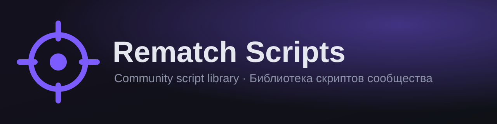
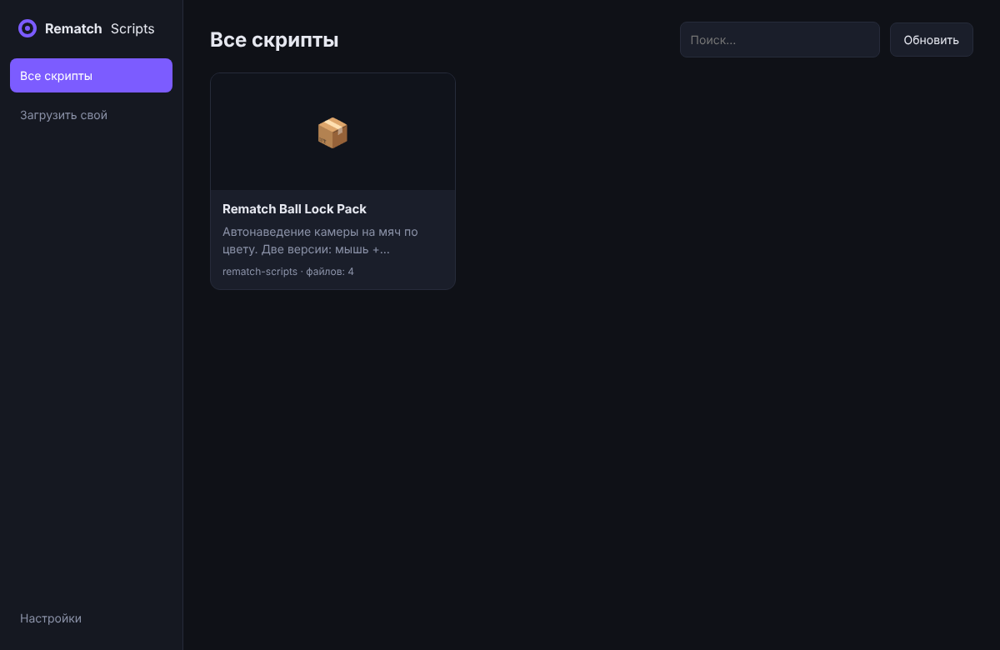
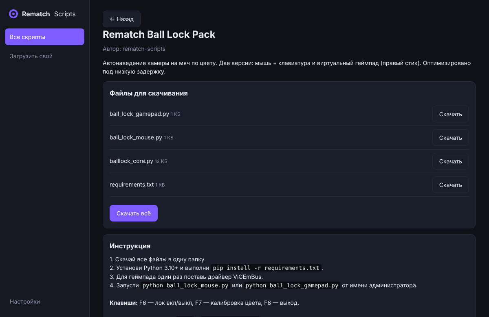
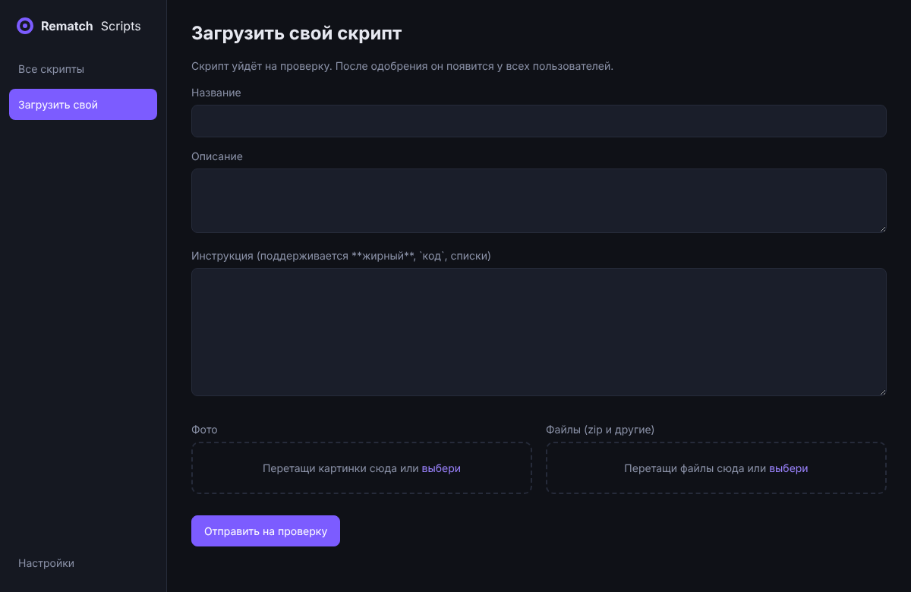

<p align="center"></p>

<p align="center">
  <a href="../../releases/latest"></a>
  
  
  <a href="LICENSE"></a>
</p>

<p align="center"><b>🇷🇺 <a href="#-русский">Русский</a></b> &nbsp;·&nbsp; <b>🇬🇧 <a href="#-english">English</a></b></p>

---

## 🇷🇺 Русский

**Rematch Scripts** — Windows-приложение с общей библиотекой скриптов. Открой каталог, выбери скрипт, скачай файлы и следуй инструкции. Хочешь поделиться своим — загрузи его прямо из приложения.

### ✨ Возможности
- 📚 **Каталог скриптов** с поиском, фото, описанием и инструкцией
- ⬇️ **Скачивание** файлов в один клик (по одному или все сразу)
- 🎛️ **Меню с тумблерами** и настройками каждого скрипта, **оверлей поверх игры**
- 🔒 Загружать скрипты может только владелец библиотеки
- 🌙 **Тёмная тема** и 🌍 интерфейс на русском и английском

### 📸 Скриншоты
<p align="center">
  
  
  
</p>

### 🚀 Установка
1. Открой раздел **[Releases](../../releases/latest)**.
2. Скачай `Rematch Scripts Setup ….exe` (установщик) или `Rematch Scripts ….exe` (portable).
3. Запусти. Если Windows покажет предупреждение SmartScreen: **Подробнее → Выполнить в любом случае**.
4. Один раз установи [Python 3.10+](https://www.python.org/downloads/) (галочка *Add python.exe to PATH*). Остальное приложение ставит само.

### 🎛️ Меню и оверлей
1. **Все скрипты** → выбери скрипт → **Скачать и добавить в меню**.
2. **Меню скриптов**: включай тумблером, настраивай шестерёнкой.
3. **F10** открывает то же меню поверх игры (перезапускать игру не нужно).

📖 Полная инструкция: [`docs/guide.html`](docs/guide.html)

### ⚠️ Важно
Скрипты запускаются на твоём компьютере и могут нарушать правила онлайн-игр. **Используй на свой риск.**

---

## 🇬🇧 English

**Rematch Scripts** is a Windows app with a shared script library. Browse the catalog, pick a script, download its files and follow the instructions. Want to share your own? Upload it right from the app.

### ✨ Features
- 📚 **Script catalog** with search, photos, descriptions and instructions
- ⬇️ **One-click downloads** (single file or everything)
- 🎛️ **Menu with toggles** and per-script settings, **in-game overlay**
- 🔒 Only the library owner can upload scripts
- 🌙 **Dark theme** and 🌍 Russian / English interface

### 🚀 Installation
1. Open **[Releases](../../releases/latest)**.
2. Download `Rematch Scripts Setup ….exe` (installer) or `Rematch Scripts ….exe` (portable).
3. Run it. If Windows SmartScreen warns you: **More info → Run anyway**.
4. Install [Python 3.10+](https://www.python.org/downloads/) once (tick *Add python.exe to PATH*). The app installs everything else itself.

### 🎛️ Menu and overlay
1. **All scripts** → pick a script → **Download & add to menu**.
2. **Script menu**: switch with the toggle, configure with the gear.
3. **F10** opens the same menu on top of the game (no game restart needed).

📖 Full guide: [`docs/guide.html`](docs/guide.html)

### ⚠️ Important
Scripts run on your computer and may break online-game rules. **Use at your own risk.**

---

## 🛠️ Development
```bash
npm install
npm start          # run the app
npm run dist       # build the Windows exe (on Windows)
```
Library layout: `library/<id>/script.json`, `files/`, `images/`. The index `library/index.json` is generated by GitHub Actions.
Set your GitHub username in `config.json` (`owner`) before building.

## 🤝 Contributing
See [CONTRIBUTING.md](CONTRIBUTING.md). Licensed under [MIT](LICENSE).
